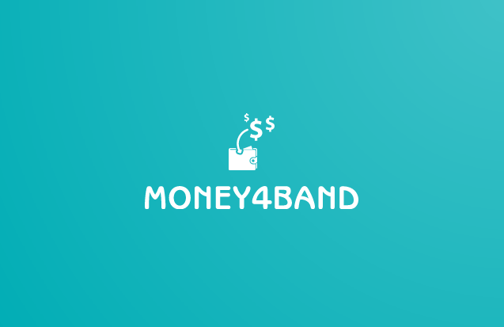
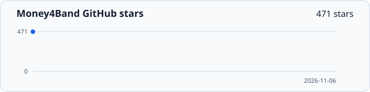

  

<h1 align="center">Money4Band</h1>

<h3 align="center">Run bandwidth-sharing apps with Docker Compose.</h3>

  
  
  
  

  
  
  

## What is Money4Band?

Money4Band (M4B) is an open-source manager for bandwidth-sharing apps such as
Honeygain, Pawns, PacketStream, and Repocket. Choose the apps you want, enter
their provider credentials, and run them together in Docker Compose.

- [Quick Start](#quick-start)
- [Key Features](#key-features)
- [Supported Apps](#supported-apps)
- [Documentation](#documentation)
- [FAQ](#faq)
- [Community & Support](#community--support)
- [Contributing](#contributing)
- [License](#license)

## Quick Start

1. Start Docker. Check the [platform requirements](docs/getting-started.md#prerequisites).
2. Download the executable for your platform from the
   [latest stable release](https://github.com/MRColorR/money4band/releases/latest),
   or pick a prerelease from [all releases](https://github.com/MRColorR/money4band/releases).
   Follow the [platform-specific launch steps](docs/getting-started.md#option-a---download-the-binary-recommended).
3. Open **Setup Apps**, select your apps, and provide the requested credentials.
   Leave proxies off for a direct connection, or follow the [proxy setup guide](docs/proxy-setup.md).
4. Choose **Start Stack**, then check the containers in the dashboard or with
   the [status command](docs/cli-reference.md#status).

Prefer a Git checkout? Follow [Run from Source](docs/getting-started.md#option-b---run-from-source).
Already installed? See [Upgrade an existing installation](docs/getting-started.md#upgrade-an-existing-installation).

## Key Features

- Guided setup, scriptable CLI, and a web dashboard with a REST API
- Direct, single-proxy, and multi-proxy Docker Compose stacks
- Encrypted saved credentials, configuration profiles, and backup and restore
- Optional app image updates with Watchtower, plus a separate Money4Band updater
- Per-app resource limits, notifications, and opt-in community catalogs

## Supported Apps

Start with any app marked **Built into Money4Band**. Optional apps can be
enabled through the community catalog. Standalone apps use the provider's
own installer. Some app names link to referrals that support the project.

<!-- BEGIN:APPS_TABLE -->
| App | How to run it |
| --- | --- |
| [**AntGain**](https://antgain.app) | Built into Money4Band |
| [**Bitping**](https://app.bitping.com?r=qm7mIuX3) | Built into Money4Band |
| [**Earn.FM**](https://earn.fm/ref/MATTTAV6) | Built into Money4Band |
| [**GaGaNode**](https://www.gaganode.com) | Optional community catalog |
| [**Honeygain**](https://r.honeygain.me/MINDL15721) | Built into Money4Band |
| [**Mysterium**](https://mystnodes.co/?referral_code=Tc7RaS7Fm12K3Xun6mlU9q9hbnjojjl9aRBW8ZA9) | Built into Money4Band |
| [**NetYield**](https://netyield.io/) | Built into Money4Band |
| [**PacketStream**](https://packetstream.io/?psr=3zSD) | Built into Money4Band |
| [**Pawns (IPRoyal)**](https://pawns.app?r=MiNe) | Built into Money4Band |
| [**ProxyLite**](https://proxylite.ru/?r=PJTKXWN3) | Built into Money4Band |
| [**Proxyrack Peer Program**](https://peer.proxyrack.com/ref/myoas6qttvhuvkzh8ffx90ns1ouhwgilfgamo5ex) | Built into Money4Band |
| [**Repocket**](https://link.repocket.co/hr8i) | Built into Money4Band |
| [**Spide Network**](https://spide.network) | Optional community catalog |
| [**Titan Network**](https://titannet.io) | Built into Money4Band |
| [**TraffMonetizer**](https://traffmonetizer.com/?aff=366499) | Built into Money4Band |
| [**URnetwork**](https://urnetwork.com) | Built into Money4Band |
| [**EarnApp**](https://earnapp.com/i/3zulx7k) | Standalone install |
| [**Adnade**](https://adnade.com) | Candidate (see app directory) |
| [**ByteBenefit**](https://bytebenefit.com) | Candidate (see app directory) |
| [**Bytelixir**](https://bytelixir.com) | Candidate (see app directory) |
| [**Earn.cc**](https://earn.cc) | Candidate (see app directory) |
| [**Ebesucher**](https://www.ebesucher.com) | Candidate (see app directory) |
| [**PassiveApp**](https://passiveapp.io) | Candidate (see app directory) |
| [**Salad**](https://salad.com) | Candidate (see app directory) |
| [**UpRock**](https://uprock.com) | Candidate (see app directory) |
| **BearShare** | Archived |
| [**Dawn Internet**](https://dawninternet.com?code=xo23vynw) | Archived |
| [**Gradient**](https://app.gradient.network/signup?code=9WOBKP) | Archived |
| [**Grass (Wynd Network)**](https://app.getgrass.io/register/?referralCode=qyvJmxgNUhcLo2f) | Archived |
| **PacketShare** | Archived |
| [**Peer2Profit**](https://t.me/peer2profit_app_bot?start=165849012262da8d0aa13c8) | Archived |
| [**ProxyBase**](http://peer.proxybase.org/signup?ref=XfOz3zeURm) | Archived |
| [**SpeedShare**](https://speedshare.app/?ref=mindlessnerd) | Archived |
| [**Teneo Protocol**](https://dashboard.teneo.pro/?code=qPgLn) | Archived |
| [**Wipter**](https://wipter.com/signup?ref=money4band) | Archived |
| [**WizardGain**](https://wizardgain.com) | Archived |
<!-- END:APPS_TABLE -->

See the [app directory](docs/APPS.md) for setup options, IP eligibility, and payout methods.

---

## Documentation

| | |
|---|---|
| [Getting Started](docs/getting-started.md) | [CLI Reference](docs/cli-reference.md) |
| [Dashboard & API](docs/dashboard-api.md) | [Proxy Setup](docs/proxy-setup.md) and [Proxy Providers](docs/proxy-setup.md#proxy-providers) |
| [App Management](docs/app-management.md) | [Configuration](docs/configuration.md) |
| [Security](docs/security.md) | [Notifications](docs/notifications.md) |
| [FAQ & Troubleshooting](docs/faq.md) | [App Directory](docs/APPS.md) |

---

## FAQ

- [Why is EarnApp missing from setup?](docs/faq.md#why-is-earnapp-missing-from-setup)
- [How do I update Money4Band?](docs/faq.md#how-do-i-update-m4b)
- [How do I troubleshoot setup or containers?](docs/faq.md#setup-issues)

## Community & Support

- [**Discord**](https://discord.com/invite/Fq8eeazBAD) for chat, help, and shared experiences
- [**Discussions**](https://github.com/MRColorR/money4band/discussions) for feature requests and ideas
- [**Issues**](https://github.com/MRColorR/money4band/issues) for bug reports

## Contributing

Contributions are welcome! Please read the [Contributing Guide](.github/CONTRIBUTING.md) and [Code of Conduct](.github/CODE_OF_CONDUCT.md) before opening a pull request.

---

## Support

Ko-fi supports MrColorRain's work across projects.

Support ongoing development, testing and documentation through
[Ko-fi](https://ko-fi.com/mrcolorrain). One-time contributions and monthly
memberships are welcome, and you can pledge above a tier's minimum.
Technical decisions remain independent.

See the [supporters and sponsors directory](https://github.com/MRColorR/MRColorR/blob/main/SPONSORS.md)
for acknowledgments.

---

## Stargazers

---

## License

Money4Band is licensed under [GPL-3.0](LICENSE).

## [!] Disclaimer

This project and its artifacts are provided "as is" and without warranty of any kind. The author makes no warranties, express or implied, that this script is free of errors, defects, or suitable for any particular purpose. The author shall not be retained liable for any damages suffered by any user of this script, whether direct, indirect, incidental, consequential, or special, arising from the use of or inability to use this script or its documentation, even if the author has been advised of the possibility of such damages. Always verify that the laws of your country and your ISP's terms allow these applications.
