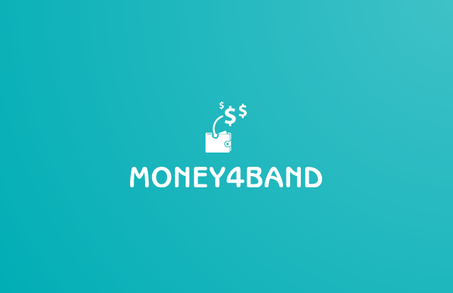

<p align="center">
  
</p>

<h1 align="center">Money4Band</h1>

<h3 align="center">Earn passive income from your unused bandwidth — one command, all apps.</h3>

<p align="center">
  <a href="https://github.com/MRColorR/money4band/releases/latest"></a>
  <a href="https://github.com/MRColorR/money4band/actions/workflows/release-on-tag.yml"></a>
  <a href="https://github.com/MRColorR/money4band/stargazers"></a>
  <a href="https://github.com/MRColorR/money4band/blob/main/LICENSE"></a>
  <a href="https://discord.com/invite/Fq8eeazBAD"></a>
</p>

<p align="center">
  
  
  
</p>

<p align="center"><b>If you like this project, leave a ⭐. It helps more than you think.</b></p>

---

## Table of Contents

- [What is Money4Band?](#what-is-money4band)
- [Prerequisites](#prerequisites)
- [Quick Start](#-quick-start)
- [Key Features](#-key-features)
- [Supported Apps](#-supported-apps)
- [Tested On](#-tested-on)
- [Documentation](#-documentation)
- [Community & Support](#-community--support)
- [Contributing](#-contributing)

---

## What is Money4Band?

**Money4Band (M4B)** turns your unused internet bandwidth into passive income. That bandwidth is there anyway whether you're using it or not. Why not put it to work? One command. All the bandwidth-sharing apps. Each one runs in its own isolated Docker container, so your system stays clean, your setup is safer than installing each app natively, and you earn more than any single app could deliver alone.

Our maintainers and community **research** every app, **verify** its background, **track** payout history, and **monitor** real-world behavior over time. You don't have to figure out which apps are legit and which are a waste of time. That work is already done.

## Prerequisites

| Requirement | Details |
|-------------|---------|
| **Docker** | Docker Engine 20.10+ or Docker Desktop |
| **OS** | Windows 10/11 (WSL2), Linux, macOS |
| **Architecture** | amd64 or arm64 |
| **RAM** | 1 GB minimum (2 GB+ recommended) |
| **Python** | 3.10+ (only for "from source" installs) |

## ⚡ Quick Start

### Option A: Download & Run (recommended)

1. Go to the [**Releases Page**](https://github.com/MRColorR/money4band/releases/latest)
2. Download the latest release for your OS and extract it
3. Run it:
   - **Windows:** `money4band.exe`
   - **Linux / macOS:** `./money4band`

### Option B: From source

```bash
git clone https://github.com/MRColorR/money4band.git && cd money4band
uv sync && uv run python main.py
```

> **No uv?** `pip install -r requirements.txt && python3 main.py` also works.

> See the [**Full Setup Guide**](https://github.com/MRColorR/money4band/wiki) for details.

### What Happens Next?

1. **Follow the guided setup.** M4B walks you through configuring each app.
2. **Start the stack.** One command launches everything.
3. **Watch it work.** Check your dashboard, see the earnings come in.

---

## 🚀 Key Features

- 🧭 **CLI + Guided Setup.** Interactive wizard for beginners, `m4b` subcommands for power users — no Docker Compose files or manual configs needed.
- 🔒 **Safer than running apps natively.** Every app runs in its own isolated Docker container — no host installs, no conflicts, no leftover junk.
- 🔐 **Encrypted credentials.** All tokens, passwords, and API keys are encrypted at rest. Nothing is stored in plain text.
- 🌍 **Multi-proxy scaling.** Multiple IPs, multiple instances, one unified configuration.
- 🔄 **Auto-updates.** Watchtower keeps every app image fresh without you doing anything.
- 📊 **Web dashboard.** All your apps, one clean interface.
- 🧠 **Auto-claim sidecars.** Daily rewards like Lucky Pot are claimed automatically for you.
- 🧩 **Resource limit profiles.** Fine-tune CPU and RAM per app with simple presets.
- 🛰️ **IP quality scoring.** Know your IP reputation before deploying.
- 💾 **Backup & restore.** One command to back up or restore your encrypted config.
- 🔔 **Webhook notifications.** Stack events pushed to Discord, Telegram, or anywhere Shoutrrr reaches.
- 🖥️ **Cross-platform.** Windows, Linux, macOS. amd64 and arm64.
- 🔧 **Self-update.** `m4b update` keeps the CLI itself up to date.

---

## 📋 Supported Apps

**34 apps** tracked. [Full details, earnings estimates, and registration links here.](docs/APPS.md)

> App links below include referral codes that support the project at no cost to you.

<!-- BEGIN:APPS_TABLE -->
| App | Residential | VPS/DC | Payout |
|-----|:-----------:|:------:|--------|
| [**AntGain**](https://antgain.app) | ✅ | — | — |
| [**BearShare**](https://bearshare.io) | ✅ | — | — |
| [**Bitping**](https://app.bitping.com?r=qm7mIuX3) | ✅ | ✅ | BITPING token (crypto), USDC |
| [**Earn.FM**](https://earn.fm/ref/MATTTAV6) | ✅ | ✅ | PayPal, USDT, gift cards |
| [**GaGaNode**](https://www.gaganode.com) | ✅ | — | GaGa token (crypto) |
| [**Gradient**](https://app.gradient.network/signup?code=9WOBKP) | ✅ | — | — |
| [**Honeygain**](https://r.honeygain.me/MINDL15721) | ✅ | ❌ | JumpToken (crypto), PayPal (via JumpTask) |
| [**Pawns (IPRoyal)**](https://pawns.app?r=MiNe) | ✅ | ❌ | PayPal, crypto, gift cards |
| [**Mysterium**](https://mystnodes.co/?referral_code=Tc7RaS7Fm12K3Xun6mlU9q9hbnjojjl9aRBW8ZA9) | ✅ | ✅ | MYST token, ETH, BNB |
| [**PacketShare**](https://www.packetshare.io/?code=A260871CFD822E35) | ✅ | — | — |
| [**PacketStream**](https://packetstream.io/?psr=3zSD) | ✅ | ❌ | PayPal |
| [**ProxyBase**](http://peer.proxybase.org/signup?ref=XfOz3zeURm) | — | — | — |
| [**ProxyLite**](https://proxylite.ru/?r=PJTKXWN3) | ✅ | ✅ | crypto |
| [**Proxyrack Peer Program**](https://peer.proxyrack.com/ref/myoas6qttvhuvkzh8ffx90ns1ouhwgilfgamo5ex) | ✅ | ✅ | PayPal, crypto |
| [**Repocket**](https://link.repocket.co/hr8i) | ✅ | ✅ | PayPal, crypto |
| [**Spide Network**](https://spide.network) | ✅ | ✅ | PayPal, crypto |
| [**Titan Network**](https://titannet.io) | ✅ | — | — |
| [**TraffMonetizer**](https://traffmonetizer.com/?aff=366499) | ✅ | ✅ | PayPal, crypto, wire transfer |
| [**URnetwork**](https://urnetwork.com) | ✅ | — | — |
| [**WizardGain**](https://wizardgain.com) | ✅ | ✅ | — |
| [**Adnade**](https://adnade.com) | ✅ | — | — |
| [**ByteBenefit**](https://bytebenefit.com) | ✅ | — | — |
| [**Bytelixir**](https://bytelixir.com) | ✅ | — | crypto |
| [**Earn.cc**](https://earn.cc) | ✅ | — | — |
| [**Ebesucher**](https://www.ebesucher.com) | ✅ | — | — |
| [**PassiveApp**](https://passiveapp.io) | ✅ | — | — |
| [**Salad**](https://salad.com) | ✅ | ❌ | — |
| [**UpRock**](https://uprock.com) | ✅ | — | — |
| [**Dawn Internet**](https://dawninternet.com?code=xo23vynw) | ✅ | — | — |
| [**Grass (Wynd Network)**](https://app.getgrass.io/register/?referralCode=qyvJmxgNUhcLo2f) | ✅ | ❌ | GRASS token (crypto) |
| [**Peer2Profit**](https://t.me/peer2profit_app_bot?start=165849012262da8d0aa13c8) | — | — | — |
| [**SpeedShare**](https://speedshare.app/?ref=mindlessnerd) | — | — | — |
| [**Teneo Protocol**](https://dashboard.teneo.pro/?code=qPgLn) | ✅ | — | — |
| [**Wipter**](https://wipter.com/signup?ref=money4band) | — | — | — |
<!-- END:APPS_TABLE -->

> 📋 **[Registration links, earnings estimates, and full details](docs/APPS.md)**

---

## 🧪 Tested On

| Platform | Architecture | Devices |
|----------|:------------|:--------|
| Windows 11 (WSL2) | amd64, arm64 | Desktop, Laptop |
| Linux (Debian/Ubuntu) | amd64, arm64 | Desktop, Laptop, Raspberry Pi |
| macOS | amd64, arm64 | MacBook Pro |

---

## 📖 Documentation

| | |
|---|---|
| 📖 [Getting Started](docs/getting-started.md) | 🏗️ [Architecture](docs/ARCHITECTURE.md) |
| 📋 [CLI Reference](docs/cli-reference.md) | 📦 [Package Structure](docs/package-structure.md) |
| 📊 [Dashboard & API](docs/dashboard-api.md) | 🌍 [Proxy & Multi-Proxy](docs/proxy-setup.md) |
| 🧩 [App Management](docs/app-management.md) | ⚙️ [Configuration](docs/configuration.md) |
| 🔒 [Security](docs/security.md) | 🔔 [Notifications](docs/notifications.md) |
| ❓ [FAQ & Troubleshooting](docs/faq.md) | 📋 [App Directory](docs/APPS.md) |

---

## 💬 Community & Support

- 🚀 [**Discord**](https://discord.com/invite/Fq8eeazBAD) for chat, help, and shared experiences
- 💡 [**Discussions**](https://github.com/MRColorR/money4band/discussions) for feature requests and ideas
- 🐛 [**Issues**](https://github.com/MRColorR/money4band/issues) for bug reports

## 🤝 Contributing

Contributions are welcome! Please read the [Contributing Guide](.github/CONTRIBUTING.md) and [Code of Conduct](.github/CODE_OF_CONDUCT.md) before opening a pull request.

---

<details>
<summary>💝 <b>Support the Project</b></summary>

If M4B saves you time or earns you money, consider giving back. Every bit helps keep this project alive.

**Crypto:**
- **BTC:** `1EzBrKjKyXzxydSUNagAP8XLeRzBTxfHcg`
- **ETH:** `0xE65c32004b968cd1b4084bC3484C0dA051eeD3ee`
- **SOL:** `6kUAWW8q5169qnUJdxxLsNMPpaKPvbUSmryKDYTb9epn`
- **BNB:** `0xE65c32004b968cd1b4084bC3484C0dA051eeD3ee`

**Platforms:**
[Patreon](https://patreon.com/mrcolorrain) · [Buy Me a Coffee](https://buymeacoffee.com/mrcolorrain) · [Ko-fi](https://ko-fi.com/mrcolorrain)

</details>

---

## Stargazers

[](https://starchart.cc/MRColorR/money4band)

---

## ⚠️ Disclaimer

This project and its artifacts are provided "as is" and without warranty of any kind. The author makes no warranties, express or implied, that this script is free of errors, defects, or suitable for any particular purpose. The author shall not be retained liable for any damages suffered by any user of this script, whether direct, indirect, incidental, consequential, or special, arising from the use of or inability to use this script or its documentation, even if the author has been advised of the possibility of such damages. Always verify that the laws of your country and your ISP's terms allow these applications.
