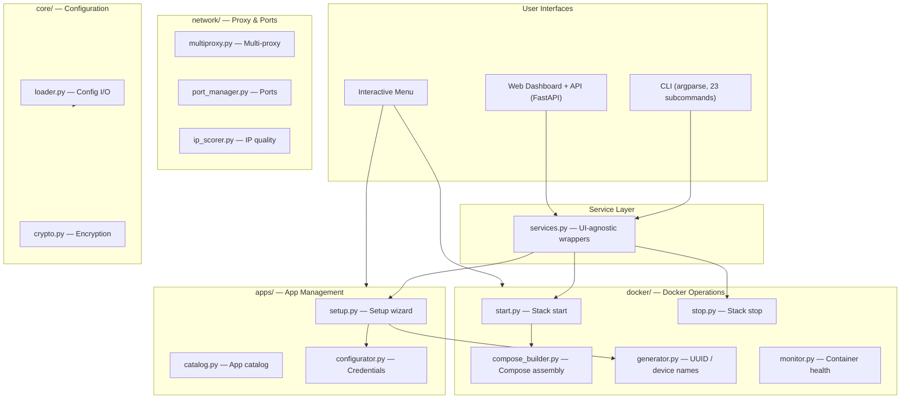

# M4B v5.0.0 — Architecture

> Technical overview of the Money4Band system architecture.

---

## High-Level Overview



---

## Entry Point

**`main.py`** is the single entry point for both CLI and binary distribution.

```
User → main.py → argparse (23 subcommands)
                → _SUBCOMMAND_DISPATCH[cmd](args)
                → subpackage module .main()
```

When no subcommand is given, `mainmenu()` launches the interactive menu using a **static dispatch table** that maps m4b-config.json menu entries to module functions.

### Startup Sequence

1. Resolve `BASE_DIR` (handles PyInstaller frozen vs. script mode)
2. Parse CLI arguments
3. Configure logging (rotating file + console, JSON formatter)
4. Register encryption hooks (`atexit` + `SIGTERM`)
5. Install credential scrub filter
6. Check for updates
7. Dispatch to subcommand or interactive menu

### CLI Subcommands

| Subcommand | Module | Purpose |
|------------|--------|---------|
| `setup` | `apps.setup` | Interactive setup wizard |
| `start` | `docker.start` | Start Docker Compose stack |
| `stop` | `docker.stop` | Stop Docker Compose stack |
| `status` | `docker.monitor` | Container status + health |
| `generate` | `docker.generator` | Regenerate compose + .env |
| `links` | `apps.catalog` | App dashboard & referral links |
| `reset` | `core.reset` | Reset user-config to template |
| `proxy` | `network.proxy_tools` | Multi-proxy management |
| `backup` | `core.backup` | Create encrypted config backup |
| `restore` | `core.backup` | Restore config from backup |
| `update` | `updater` | Check/apply M4B updates |
| `config` | `core.viewer` | View or edit config |
| `limit` | `system.detector` | Resource limit profile |
| `ip` | `network.ip_scorer` | IP quality analysis |
| `info` | `system.info` | System information |
| `dns` | `system.info` | Container DNS config |
| `notify` | `notifier` | Notification status + test |
| `apps` | `apps.info` | List apps or show detail |
| `validate` | `docker.image_security` | Image security checks |
| `app` | `apps.wizard` | App plugin management |
| `offers` | `apps.offers` | Referral & passive income |
| `dashboard` | `dashboard.cli` | Web Dashboard + API |
| `profile` | `core.profiles` | Config profiles |

---

## Package Structure

```
money4band/
├── apps/           App management, catalog, setup, earnings
├── core/           Configuration I/O, crypto, backup, profiles
├── docker/         Compose assembly, stack ops, monitoring
├── network/        HTTP, ports, proxy, IP scoring
├── system/         OS detection, system info, resource profiles
├── ui/             Terminal prompts, banner, display
├── api/            FastAPI REST API (13 routers)
├── dashboard/      Web Dashboard lifecycle
├── resources/      Static assets (packaged with binary)
├── notifier.py     Webhook notifications
├── services.py     UI-agnostic service layer
├── updater.py      Self-update mechanism
└── structured_logging.py  JSON logging
```

See [Package Details](package-structure.md) for the full module inventory.

---

## Configuration System

| File | Purpose | Sensitive? |
|------|---------|-----------|
| `config/m4b-config.json` | Project settings, ports, menu, profiles, DNS | No |
| `config/app-config.json` | Per-app Docker definitions, metadata (35 apps) | No |
| `config/user-config.json` | Credentials, preferences, proxy config | **Encrypted at rest** |

Credentials are encrypted with **Fernet (AES-128-CBC + HMAC-SHA256)**. The master key lives at `~/.m4b/master.key` with restricted permissions. Auto-encrypt on exit via `atexit` + `SIGTERM` handlers.

---

## Compose Architecture

Docker Compose files can be generated in **monolithic** or **layered** mode.

### Layered Mode (6 files)

| Layer | File | Purpose |
|-------|------|---------|
| base | `compose.yml` | Network, watchtower |
| residential | `compose.residential.yml` | Residential-IP apps |
| datacenter | `compose.datacenter.yml` | Datacenter-OK apps |
| universal | `compose.universal.yml` | Any-IP apps |
| service | `compose.service.yml` | Auto-claim sidecars |
| proxy | `compose.proxy.yml` | VPN tunnel |

### Security Hardening

- `security_opt: [no-new-privileges:true]` on all services
- `read_only: true` on Watchtower
- Centralised DNS injection
- Watchtower scope labels for multi-instance isolation

---

## Binary Distribution

PyInstaller builds for 5 platform targets:

| OS | Arch | Method |
|----|------|--------|
| Linux | x64 | Native |
| Linux | arm64 | Docker + QEMU |
| Linux | arm/v7 | Docker + QEMU |
| macOS | x64 | Native |
| Windows | x64 | Native |
