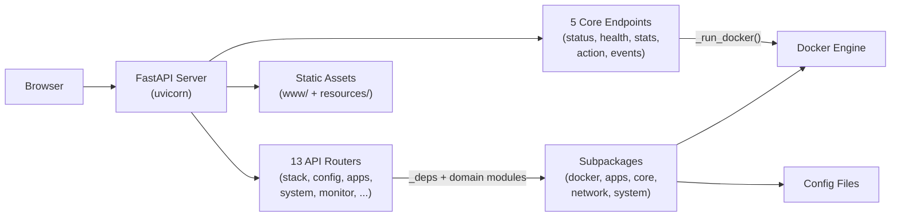

# Web Dashboard & REST API

> Monitor and control your M4B stack from a browser.

---

## Overview

Money4Band includes a **FastAPI-powered web dashboard** with a REST API. It runs locally on your machine and provides:

- Real-time container status and health
- Start / stop / restart individual containers
- Live CPU & memory stats
- Configuration viewing
- SSE (Server-Sent Events) for live updates

## Starting the Dashboard

### From CLI

```bash
# Foreground (logs to terminal)
m4b dashboard start

# Background (detached process)
m4b dashboard start   # from the interactive menu, choose "Start background"

# Restart the dashboard
m4b dashboard restart

# Web-exposed (accessible from other devices)
m4b dashboard restart --host 0.0.0.0

# Auto-start with any command
m4b --dashboard true stack start
```

### From Interactive Menu

Choose **Dashboard** -> **Start foreground**, **Start background**, **Start (web-exposed)**, or **Restart**.

### Auto-Start

Enable auto-start so the dashboard launches whenever you run any M4B command:

```bash
m4b dashboard enable
```

Disable with `m4b dashboard disable`.

## Accessing the Dashboard

Once started, the dashboard is available at:

```
http://localhost:8088
```

The port is configurable via `config/user-config.json` -> `dashboard.port`.

## API Authentication

- **Localhost requests**: No authentication required (when binding to `127.0.0.1`)
- **Web-exposed mode** (`0.0.0.0`): All API requests require authentication

### Browser (cookie-based)

When you open the dashboard in a browser while running web-exposed, you are
prompted for the API key on first visit. The key is stored as an `httpOnly`
cookie (`m4b_token`) so every subsequent request is authenticated
automatically.

You can also pass the key via URL parameter for one-click access:

```
http://<host>:8088/?token=YOUR_KEY
```

The token is stripped from the URL bar after login to avoid leaking it in
browser history.

### CLI / cURL (Bearer token)

For programmatic access use the `Authorization` header:

```bash
curl -H "Authorization: Bearer YOUR_KEY" http://localhost:8088/api/status
```

### Key management

```bash
# Show your API key
m4b dashboard show-key

# Regenerate the API key
m4b dashboard regenerate-key
```

### Auth endpoints

| Method | Endpoint | Description |
|--------|----------|-------------|
| `POST` | `/api/auth/login` | Validate key and set session cookie |
| `POST` | `/api/auth/logout` | Clear session cookie |

## API Endpoints

### Container Management

| Method | Endpoint | Description |
|--------|----------|-------------|
| `GET` | `/api/status` | Container status + Docker availability |
| `GET` | `/api/health` | Health check results for all containers |
| `GET` | `/api/stats` | CPU & memory usage per container |
| `POST` | `/api/action/{container}/{action}` | Start / stop / restart a container |
| `GET` | `/api/events` | SSE stream - live container status (5s poll) |

### Stack Operations

| Method | Endpoint | Description |
|--------|----------|-------------|
| `POST` | `/api/stack/start` | Start the full Docker Compose stack |
| `POST` | `/api/stack/stop` | Stop the running stack |
| `POST` | `/api/stack/restart` | Restart the stack |

### Configuration

| Method | Endpoint | Description |
|--------|----------|-------------|
| `GET` | `/api/config/dashboard` | Dashboard auto-start status, port, and running state |
| `PUT` | `/api/config/dashboard` | Update dashboard auto-start (`enabled`) and/or `port` |

### Everything else

The remaining routers cover apps, catalog, config, system, monitor, backups,
profiles, earnings, IP, notifications, update and security. They are generated
from the code, so read them at the OpenAPI page rather than from a table that
can drift:

```
http://localhost:8088/api/docs
```

## Architecture



The core endpoints (`/api/status`, `/api/health`, `/api/stats`, `/api/action`, `/api/events`) talk to Docker directly via subprocess calls. The 13 modular routers delegate to the same domain subpackages used by the CLI and interactive menu, ensuring consistent behavior across all interfaces.
