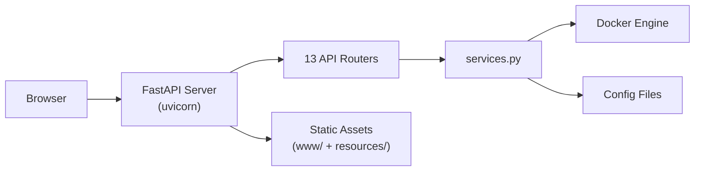

# Web Dashboard & REST API

> Monitor and control your M4B stack from a browser.

---

## Overview

Money4Band includes a **FastAPI-powered web dashboard** with a REST API. It runs locally on your machine and provides:

- Real-time container status and health
- Start / stop / restart individual containers
- Live CPU & memory stats
- Configuration viewing
- SSE (Server-Sent Events) for live updates

## Starting the Dashboard

### From CLI

```bash
# Foreground (logs to terminal)
m4b dashboard start

# Background (detached process)
m4b dashboard start   # from the interactive menu, choose "Start background"

# Auto-start with any command
m4b --dashboard true start
```

### From Interactive Menu

Choose **Dashboard** → **Start foreground** or **Start background**.

### Auto-Start

Enable auto-start so the dashboard launches whenever you run any M4B command:

```bash
m4b dashboard enable
```

Disable with `m4b dashboard disable`.

## Accessing the Dashboard

Once started, the dashboard is available at:

```
http://localhost:8088
```

The port is configurable via `config/user-config.json` → `dashboard.port`.

## API Authentication

- **Localhost requests**: No authentication required (when not exposed)
- **Remote / exposed mode**: Requires Bearer token authentication

```bash
# Show your API key
m4b dashboard show-key

# Regenerate the API key
m4b dashboard regenerate-key
```

Use the key in API requests:

```bash
curl -H "Authorization: Bearer YOUR_KEY" http://localhost:8088/api/status
```

## API Endpoints

### Container Management

| Method | Endpoint | Description |
|--------|----------|-------------|
| `GET` | `/api/status` | Container status + Docker availability |
| `GET` | `/api/health` | Health check results for all containers |
| `GET` | `/api/stats` | CPU & memory usage per container |
| `POST` | `/api/action/{container}/{action}` | Start / stop / restart a container |
| `GET` | `/api/events` | SSE stream — live container status (5s poll) |

### Configuration

| Method | Endpoint | Description |
|--------|----------|-------------|
| `GET` | `/api/config/...` | Configuration endpoints |
| `GET` | `/api/apps/...` | App catalog & details |
| `GET` | `/api/system/...` | System information |

### Other

| Method | Endpoint | Description |
|--------|----------|-------------|
| `GET` | `/api/monitor/...` | Monitoring data |
| `GET` | `/api/backups/...` | Backup management |
| `GET` | `/api/profiles/...` | Config profiles |
| `GET` | `/api/earnings/...` | Earnings estimates |
| `GET` | `/api/ip/...` | IP quality data |
| `GET` | `/api/offers/...` | Referral offers |
| `GET` | `/api/notifications/...` | Notification status |
| `GET` | `/api/update/...` | Update info |
| `GET` | `/api/security/...` | Security checks |

### Interactive API Docs

OpenAPI documentation is available at:

```
http://localhost:8088/api/docs
```

## Architecture



The dashboard shares the same `services.py` layer used by the CLI and interactive menu, ensuring consistent behaviour across all interfaces.
